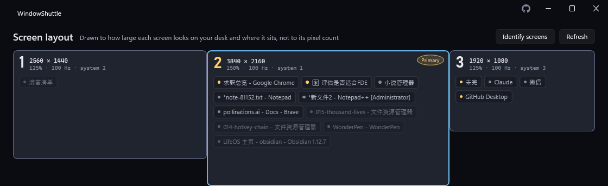

# WindowShuttle

> Verplaats vensters tussen beeldschermen zonder te slepen — één voor één of een heel scherm tegelijk

[⬇ Downloaden voor Windows](https://github.com/rockbenben/WindowShuttle/releases/latest)

[English](../../README.md) · [简体中文](../../README.zh.md) · [繁體中文](README.zh-Hant.md) · [日本語](README.ja.md) · [한국어](README.ko.md) · [Deutsch](README.de.md) · [Español](README.es.md) · [Français](README.fr.md) · [Italiano](README.it.md) · **Nederlands** · [Português](README.pt.md) · [Русский](README.ru.md) · [Türkçe](README.tr.md) · [Tiếng Việt](README.vi.md) · [ไทย](README.th.md) · [Bahasa Indonesia](README.id.md) · [हिन्दी](README.hi.md) · [العربية](README.ar.md)

 

**Een venster naar een ander beeldscherm verplaatsen hoeft geen vermoeiende sleepactie over uw hele bureau te zijn.** Houd `Ctrl` en de rechtermuisknop ingedrukt, veeg kort in de richting van het gewenste scherm en het venster onder uw cursor staat er al. Wilt u een heel scherm omwisselen? Eén sneltoets wisselt alle vensters tussen uw huidige scherm en het hoofdscherm om. WindowShuttle staat in het systeemvak en werkt direct zonder installatie.

- **Vegen in plaats van richten.** `Ctrl` + rechtermuisknop, beweeg snel richting het scherm en laat los. Misgeveegd? `Ctrl` + middelklik herstelt direct.
- **Eén venster of het hele scherm, dezelfde tool.** Zeven handige acties: venster versturen, twee schermen omwisselen of alle vensters verzamelen na het loskoppelen van een monitor.
- **Geometrie wordt herberekend, niet gekopieerd.** Volledige ondersteuning voor gemengde DPI en resoluties: vensters worden geschaald en behouden hun gemaximaliseerde of gesnapte status.
- **De kaart is uw bedieningspaneel.** Bekijk vensters op ware grootte en sleep ze eenvoudig tussen beeldschermen.
- **Geen verplichtingen, volledig offline.** Eén draagbaar uitvoerbaar bestand, geen account vereist. Alleen voor Windows.

## De zeven acties

| Actie | Sneltoets | Muisgebaar | Beschrijving |
|---|---|---|---|
| **Schermen wisselen** | `Win`+`Shift`+`X` | `Ctrl`+rechtsklik naar links | Wisselt alle vensters tussen het huidige scherm en het hoofdscherm |
| **Voorste vensters wisselen** | `Win`+`Shift`+`Z` | `Ctrl`+rechtsklik naar rechts | Wisselt alleen de voorste vensters van beide schermen |
| **Naar hoofdscherm sturen** | *(niet toegewezen)* | *(niet toegewezen)* | Verplaatst het actieve venster naar het hoofdscherm |
| **Naar volgende monitor sturen** | *(niet toegewezen)* | *(niet toegewezen)* | Verplaatst het venster naar de volgende monitor rechts |
| **Per richting sturen** | *(alleen gebaar)* | `Ctrl`+rechtsklik vegen | Verplaatst het venster onder de cursor in de geveegde richting |
| **Alles verzamelen** | *(niet toegewezen)* | *(niet toegewezen)* | Verzamelt alle vensters van secundaire schermen op het hoofdscherm |
| **Ongedaan maken** | *(niet toegewezen)* | `Ctrl`+middelklik | Maakt de vorige verplaatsing ongedaan |
| **Schermnummer** | *(niet toegewezen)* | *(niet toegewezen)* | Toont kort het identificatienummer op elk beeldscherm |

## Over het 365 Open-Source Plan

Project **#033** van het [365 Open-Source Plan](https://github.com/rockbenben/365opensource) — één persoon + AI, 300+ opensourceprojecten in een jaar.

[Een verzoek indienen →](https://365.aishort.top/) · [Discord](https://discord.gg/PZTQfJ4GjX) · [Telegram](https://t.me/aishort_top)
