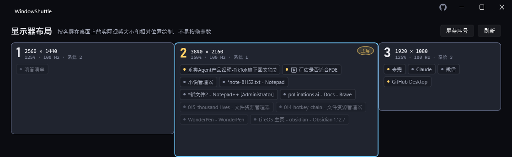

# WindowShuttle

> 在多塊螢幕之間搬視窗，不用拖：一次一扇，或整塊螢幕一起換

[⬇ 下載 Windows 版](https://github.com/rockbenben/WindowShuttle/releases/latest)

[English](../../README.md) · [简体中文](../../README.zh.md) · **繁體中文** · [日本語](README.ja.md) · [한국어](README.ko.md) · [Deutsch](README.de.md) · [Español](README.es.md) · [Français](README.fr.md) · [Italiano](README.it.md) · [Nederlands](README.nl.md) · [Português](README.pt.md) · [Русский](README.ru.md) · [Türkçe](README.tr.md) · [Tiếng Việt](README.vi.md) · [ไทย](README.th.md) · [Bahasa Indonesia](README.id.md) · [हिन्दी](README.hi.md) · [العربية](README.ar.md)

[](../../LICENSE) [](https://github.com/rockbenben/365opensource)



**把視窗挪到另一塊螢幕，不該是一次橫跨桌面的拖曳。** 按住 `Ctrl` 和右鍵，往目標螢幕的方向劃一下，游標下那扇窗就已經在那兒了。要整塊螢幕一起動？一個快速鍵把你所在螢幕和主螢幕的視窗全部對調。WindowShuttle 常駐系統匣，裝上就能用。

- **靠劃，不靠瞄。** `Ctrl`+右鍵，往那塊螢幕一甩，放開。你本來就在朝它比劃，不用先把「那是第幾塊螢幕」翻譯出來。劃錯了 `Ctrl`+中鍵 收回來。
- **一扇窗和一整塊螢幕，同一個工具。** 七個動作在同一條量級上：把這一扇送過去、把兩塊螢幕整個對調、拔了螢幕之後把散落的全收回來。鍵盤、滑鼠、系統匣選單、命令列都能觸達。
- **幾何是重算的，不是照搬的。** 混合 DPI 是主場景不是邊緣情況：尺寸按目標螢幕縮放，最大化仍是最大化，最小化還原到新螢幕，貼邊分螢幕的視窗過去還佔著那半邊、那個角。
- **地圖就是操作台。** 上半那張圖按顯示器在你桌上的真實大小和位置繪製——把視窗從一張卡片拖到另一張，它就過去了。搬完地圖會自動重畫，顯示的就是視窗此刻的位置；滑鼠懸停在被截斷的項目上可看完整標題。拖曳時，放開後將接收視窗的螢幕卡片會醒目提示。
- **不用做任何承諾。** 單一檔案綠色版，無需安裝、無需帳號。僅在手動檢查更新或啟用啟動時檢查後才會連網。僅支援 Windows。

## 它認不認你的機器

| 方面 | 支援情況 |
|---|---|
| **系統** | Windows 10 或 11 |
| **架構** | x64。只發布 x64 組建，沒有原生 ARM64 版 |
| **.NET** | 綠色版不需要；精簡版需要安裝 [.NET 10 桌面執行階段](https://dotnet.microsoft.com/download/dotnet/10.0) |
| **顯示器** | 兩塊及以上。螢幕之間的動作至少需要兩塊；單螢幕時它們會答「只有一塊顯示器」（或「沒有可搬運的視窗」），什麼都不搬 |
| **混合 DPI / 解析度** | 支援，而且正是它要解決的事：幾何按目標螢幕重算，不是逐像素照搬 |
| **系統管理員程式的視窗** | 要讓 WindowShuttle 自己也提權執行才搬得動，見[已知限制](#已知限制) |

## 下載

**[⬇ 下載最新版](https://github.com/rockbenben/WindowShuttle/releases/latest)** —— Windows x64。

- **`WindowShuttle-<版本>-win-x64.zip`** —— 綠色版，不需要額外安裝任何東西，解壓即用。拿不準就下載這個。
- **`WindowShuttle-<版本>-win-x64-needs-dotnet10.zip`** —— 同一個程式，只是不帶執行階段；需要機器上已經裝好 [.NET 10 桌面執行階段](https://dotnet.microsoft.com/download/dotnet/10.0)。體積小得多，具體多少發布頁面上有。
- **`WindowShuttle.exe`** —— 就是上面那個不含執行階段的版本，只是沒套 zip：點開即用，也可以直接蓋掉現有的那份完成更新。缺執行階段時 Windows 會自己提示下載。

三個拿到手都是同一個單一檔案 `WindowShuttle.exe`，免安裝、無需註冊。唯一的區別在啟動開銷：綠色版每次啟動都要先把自己解包到暫存目錄，因此比裝了執行階段的版本啟動得慢——命令列一次性呼叫（比如 `list`）上最明顯。這個差距只體現在一次性命令列呼叫上——常駐系統匣和快速鍵回應不受影響，這筆開銷只在啟動那一刻付一次，不會體現在每次搬窗操作裡。

程式沒有程式碼簽章，首次執行 Windows SmartScreen 會攔一下：點**其他資訊 → 仍要執行**。

**出了錯去哪查。** 某一步中途出錯，或通知/地圖重新整理這類旁路失敗時，應用程式會救回來、繼續執行，並用一張提示卡告訴你——詳情追加在 `%APPDATA%\WindowShuttle\crash.log` 裡。這個檔案只有真出過問題時才存在，找不到它本身就是答案。

**不想要了怎麼清乾淨。** 沒有安裝程式，本來也沒什麼可解除安裝的——只有一個例外：只要勾選過「以系統管理員身分」，WindowShuttle 就登記過一條**工作排程器任務**；這時候直接刪除 exe，那條任務會留在系統裡，每次登入都指向一個已經不存在的檔案。**先取消「開機自動啟動」**——它會把工作排程器任務和登錄檔項一起清掉——再刪除 exe。設定在 `%APPDATA%\WindowShuttle`，一併刪除即可。

## 七種動作

七種動作裡有六種在系統匣選單和命令列裡；「按方向送螢幕」只有滑鼠手勢，因為選單點擊或命令沒有方向。「螢幕序號」是系統匣選單和命令列裡另一個工具。出廠綁定了兩個鍵盤快速鍵、四個滑鼠手勢：

| 動作 | 鍵盤快速鍵 | 滑鼠手勢 | 幹什麼 |
|---|---|---|---|
| **整螢幕互換** | `Win`+`Shift`+`X` | `Ctrl`+右鍵向左劃 | 把你所在螢幕和主螢幕的視窗全部對調；已在主螢幕時，與上次對調過的那塊對調 |
| **對調最前視窗** | `Win`+`Shift`+`Z` | `Ctrl`+右鍵向右劃 | 只對調這兩塊螢幕各自最前面的那一個視窗，後面壓著的不管 |
| **送去主螢幕** | *(未綁定)* | *(未綁定)* | 把目前視窗送到主螢幕 |
| **送去下一個螢幕** | *(未綁定)* | *(未綁定)* | 把視窗送往右邊那塊螢幕，到頭繞回最左 |
| **按方向送螢幕** | *(無，僅手勢)* | `Ctrl`+右鍵劃向目標 | 朝著目標螢幕的方向劃一下，游標下的視窗就過去了 |
| **全部收攏** | *(未綁定)* | *(未綁定)* | 拔掉外接螢幕後，把還留在副螢幕上的視窗全部收回主螢幕 |
| **復原** | *(未綁定)* | `Ctrl`+中鍵點擊 | 把上一搬運動作搬過的所有視窗送回原位（整螢幕對調的兩批也一起復原） |
| **螢幕序號** | *(未綁定)* | *(未綁定)* | 在每塊螢幕中央短暫閃出一個大號數字，告訴你哪塊是「螢幕 1」 |

下表裡的「視窗」按**你用哪隻手**解釋：滑鼠手勢認游標指著的那一扇（按**按下**那一刻算），快速鍵、系統匣選單、命令列一律認**目前視窗**（前景/焦點視窗）——兩者為什麼不同，見[已知限制](#已知限制)。

### 滑鼠手勢

滑鼠手勢全域生效，且**不需要前台焦點**：把游標移到你想搬的那扇窗上，按住修飾鍵和出發鍵劃一下即可，不需要先點一下把它啟用（避免打斷你在另一扇窗裡的輸入）。

修飾鍵和出發鍵在主視窗裡可改，出廠綁的是 **`Ctrl` + 滑鼠右鍵**。手勢靠**拖出一段距離**觸發——短擊仍然是正常的右鍵點擊，右鍵選單照常彈出；只有劃過最小死區（24 像素）時才判定為手勢，這時候出發鍵的原生事件才會被吃掉。

#### 按住 `Ctrl`+右鍵劃一下

- **往目標螢幕的方向甩：按方向送螢幕。** 游標下的那扇窗飛到那塊螢幕上，放在同樣的相對位置。
- **向左劃：整螢幕互換。** 目前螢幕和主螢幕的所有視窗整體對調。
- **向右劃：對調最前視窗。** 只交換兩邊最上面的那一扇。
- **點一下中鍵（不用劃）：復原。** 把剛才搬動的視窗退回原位。

在出發鍵按下的那一刻，WindowShuttle 記下當時游標下的視窗。劃的過程中就算游標滑出了視窗邊界，搬的仍然是按下的那一扇；如果在鬆手前目標視窗自己關閉了，這次手勢直接放棄，不會誤搬後來蓋到那個位置的視窗。

手勢不相容觸控板的多指滑動——Windows 把觸控板手勢在驅動層自己吃掉了，第三方勾不到。它針對的是桌上那隻實體滑鼠。

## 設定

主視窗底部的設定欄，以及標題列右上角的「更新」選單：

- **關閉後留在系統匣執行**（開）——關閉按鈕只是隱藏視窗。關掉這項，點關閉就是結束程式。
- **啟動時檢查更新**（預設關，在標題列的「更新」選單內）——這是本程式唯一會連網的動作。勾選後每次啟動向 GitHub 查詢是否有新版本；有就把綠色版 zip 下載下來、核對發布頁上附帶的 SHA-256，然後一張卡片告訴你新程式落在哪兒。它**不會**替換正在執行的這份：Windows 鎖著正在執行的 exe，強制覆蓋只會留下半個損毀的程式，得先把舊的關閉。選擇「更新 → 立即檢查」可以單次檢查，啟動時檢查關閉也可使用。解壓中斷後會重新下載解壓；每次檢查都會重新驗證下載包。
- **開機自動啟動**（**開**）——常駐型工具不開機自動啟動等於每次開機都少一半功能。普通檔就是一條 `HKCU\...\Run` 登錄檔項，帶 `--tray`，開機直接進系統匣、不糊你一臉視窗；你自己按兩下 exe 則正常開啟主視窗。
- **以系統管理員身分**（預設關，掛在「開機自動啟動」下）——把自啟從登錄檔項換成一條 **Run with highest privileges 的工作排程器任務**：勾選時過一次 UAC，之後每次登入靜默以系統管理員身分啟動。兩種便攜單一檔案均支援，路徑可包含空格、中文，不強制放在 Program Files。仍建議使用受保護目錄，因為可寫 exe 被替換後，工作排程器任務也會以系統管理員權限執行替換後的程式碼。操作失敗會顯示實際原因和記錄檔位置。

  這是系統管理員視窗那兩條限制（搬不動它們的視窗、它們佔前景時手勢整體失靈——後者的日常表現是「手勢忽然變成了右鍵拖曳/複製」）的**唯一完整解**——我們實測過所有旁路，包括把搬運交給系統的 `Win+Shift` 鍵，全部在 UIPI 上撞死。提權執行之後兩堵牆一起消失。

- **拔除螢幕後自動救回螢幕外視窗**（開）——拔掉外接螢幕、或休眠喚醒時外接螢幕沒跟上，Windows 偶爾會把視窗留在已經不存在的座標上。勾上這項，每次螢幕插拔事件後自動跑一次收攏（只救真正掉到所有螢幕可視區之外的視窗，不動本來就在可視螢幕上的視窗）。
- **跳過全螢幕應用程式**（開）——遊戲、看影片全螢幕時，整螢幕對調不會把它們捲進去，避免把正在全螢幕執行的遊戲切掉。關掉這項則照搬不誤。

## 命令列

WindowShuttle 是一個單一可執行檔。在它常駐期間，你可以從終端機、指令碼、桌面捷徑或其他啟動器呼叫它——發出的命令會經由具名管道（IPC）交給已在執行的實例去辦，命令列本身列印結果後立刻結束。

如果目前沒有正在執行的 WindowShuttle 實例，`WindowShuttle.exe list` 和 `--smoke` 仍會直接執行並在本處理程序內完成；其他需要搬動視窗的命令會喚起一個隱藏的常駐實例再執行操作。

| 命令 | 幹什麼 |
|---|---|
| `WindowShuttle.exe list` | 輸出目前各顯示器的幾何佈局、以及每塊螢幕上的可移動視窗（JSON 格式）。讀取狀態，不移動任何東西 |
| `WindowShuttle.exe swap` | 把目前視窗所在螢幕與主螢幕的視窗全部對調 |
| `WindowShuttle.exe swap-top` | 只對調目前螢幕和主螢幕各自最前面的視窗 |
| `WindowShuttle.exe to-primary` | 把目前前台視窗送到主螢幕 |
| `WindowShuttle.exe gather` | 把副螢幕上的視窗全部收攏回主螢幕 |
| `WindowShuttle.exe to-next` | 把目前前台視窗送到下一塊螢幕（最右塊繞回最左） |
| `WindowShuttle.exe to <n>` | 把目前前台視窗送到**第 n 塊螢幕**（n 是從 1 開始的螢幕序號，按桌面幾何從左到右排，與地圖上的大號數字一致） |
| `WindowShuttle.exe identify` | 在每塊螢幕中央短暫閃出一個大號數字 |
| `WindowShuttle.exe undo` | 復原上一次搬運 |
| `WindowShuttle.exe --tray` | 啟動並直接隱藏到系統匣（開機自動啟動使用的參數） |
| `WindowShuttle.exe --help` | 印出簡短的用法摘要 |

命令執行成功時結束碼為 0，並向 stdout 印出一行簡要的 JSON，例如 `{"action":"to-primary","moved":1}` 或 `{"action":"swap","moved":5}`。如果目標視窗搬不動（例如該視窗屬於系統管理員權限程式、而當前未提權），結束碼為 3，並輸出 `{"error":"access_denied"}`。

## 已知限制

- **系統管理員視窗**：沒提權的 WindowShuttle **搬不動**以系統管理員身分執行的程式（工作管理員、以管理員身分開啟的終端機、某些安裝程式）。原因在 Windows 的安全邊界（UIPI，使用者介面權限隔離）：低權限行程不能向高權限行程傳送視窗訊息，也不能呼叫 `SetWindowPos` 搬動它們的視窗。解法：在主視窗勾選「以系統管理員身分」，或手動以管理員身分執行一次 WindowShuttle。
- **手勢與前台系統管理員視窗**：當系統管理員程式的視窗**正處於前台**時，整個系統的滑鼠手勢都會被 Windows 攔截，WindowShuttle 接收不到滑鼠訊息（手勢會退化成系統原生的「右鍵拖曳」）。這是 UIPI 的同一限制。提權執行 WindowShuttle 可以徹底解決。
- **全螢幕應用程式預設跳過**：完全填滿一整塊顯示器且沒有標題列的視窗（如全螢幕遊戲、播放器全螢幕）預設不會被搬動。如果希望一併搬動，在設定中關閉「跳過全螢幕應用程式」。
- **無回應視窗跳過**：當某個視窗處於未回應狀態時，搬運操作會跳過它，並在命令列輸出中明確記錄 skipped 數量。
- **虛擬桌面上的視窗**：處於其他虛擬桌面上的視窗對 WindowShuttle 是不可見的（Windows 本身會將其標記為 cloaked）。這是有意為之：避免跨虛擬桌面拉扯視窗造成困惑。請先切換到該虛擬桌面再搬動。
- **桌面座標與復原機制**：地圖完全依據桌面實體像素座標繪製，包含上下堆疊與留白間隙。單螢幕時執行收攏會自動救回螢幕外的迷失視窗。若搬運部分失敗，復原僅還原成功移動的視窗；快照採用 `.pending` 暫存機制，防止儲存崩潰遺失資料。
- **便攜單文件提權自啟。** 綠色單文件支援從任意使用者可寫目錄註冊開機提權自啟任務，不強求 Program Files；但仍建議放置在受保護目錄。自動相容外層帶引號的舊任務路徑，在回讀校驗任務成功後才切換登錄檔，失敗時在 crash.log 中報告具體原因。
- **更新校驗與解包。** 每次檢查更新都會重新下載並校驗發布套件。下載內文共用檢查的截止時間，校驗和解壓在 UI 執行緒之外執行。同一處理程序內的檢查依序執行。

## 語言

支援 18 種語言（English、简体中文、繁體中文、日本語、한국어、Español、Français、Deutsch、Italiano、Português、Русский、العربية、हिन्दी、Bahasa Indonesia、Tiếng Việt、ไทย、Türkçe、Nederlands），預設跟隨系統語言，可在主視窗最底下那條設定列手動切換——切換後需要重新啟動才能在全部介面生效（WindowShuttle 會彈出視窗詢問是否立即重新啟動）。

## 從源碼構建

需要 .NET 10 SDK。僅支援 Windows。

```bash
dotnet build WindowShuttle.sln -c Debug
dotnet test tests/WindowShuttle.Core.Tests
```

執行內建自我檢查（不干擾常駐執行中的實例）：

```bash
WindowShuttle.exe --smoke
```

`--smoke` 會在 `%TEMP%\windowshuttle-smoke.txt` 中寫入 `OK`（或例外資訊）。各開關的設計背景詳見 `src/WindowShuttle.App/App.SelfCheck.cs`。

發布單一檔案版本 (win-x64)：

```bash
dotnet publish src/WindowShuttle.App -c Release -p:PublishProfile=win-x64              # 獨立版，無需執行階段
dotnet publish src/WindowShuttle.App -c Release -p:PublishProfile=win-x64-needs-dotnet10  # 輕量版，需 .NET 10 桌面執行階段
```

發布兩個設定檔後，在本地執行 `pwsh ./tools/package-release.ps1 -Tag vX.Y.Z -OutputDirectory <目錄>` 進行打包，驗證解壓後的 `--smoke` 冒煙測試並產生校驗和。CI 在上傳前也採用完全相同的指令碼。

每次推送都會執行測試、`--smoke` 自檢與命令列結束碼檢查。另一個自我檢查參數 `--shots` 則負責離屏渲染整套截圖矩陣——它對 CI 而言過於耗時，因此作為本地工具提供，詳見 [`docs/manual-checks.md`](../manual-checks.md)。推送 `v*` 標籤會額外發布兩個版本的二進位檔案、寫入 `SHA256SUMS.txt` 並附加建置來源證明（attestation），可使用 `gh attestation verify <檔案> -R rockbenben/WindowShuttle` 進行來源校驗。

任何自動化測試都無法覆蓋的項目——真實 UAC 提示、實體拔掉顯示器、系統管理員視窗佔據前景時的手勢、實體按鍵與模擬輸入的差異、以及任何肉眼評判項目——均記錄在 [`docs/manual-checks.md`](../manual-checks.md) 中。發布前請依照清單逐一檢驗。

## 關於 365 開源計劃

[365 開源計劃](https://github.com/rockbenben/365opensource) 的第 **#033** 個專案——一人 + AI，一年 300+ 個開源專案。

[提交你的點子 →](https://365.aishort.top/) · [Discord](https://discord.gg/PZTQfJ4GjX) · [Telegram](https://t.me/aishort_top)
